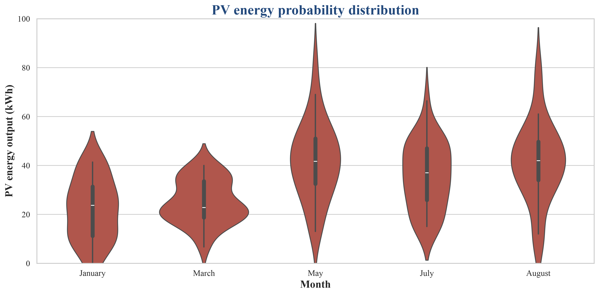

# Solis Data Pipeline
Python data pipeline for analyzing residential Solis Cloud solar inverter logs.

## Features
- **Data Ingestion:** Parses and cleans raw monthly Excel logs from Solis Cloud.
- **Data Sanitization:** Masks and removes sensitive personal/location data for privacy.
- **Statistical Analysis:** Processes time-series data to generate probability distribution models.

## Tech Stack
- **Language:** Python 3
- **Libraries:** Pandas, Matplotlib, Seaborn

## Quick Start
1. Install dependencies: `pip install -r requirements.txt`
2. Execute the pipeline to generate the visualization: `python probability_distribution.py`

## PV Energy Probability Distribution

